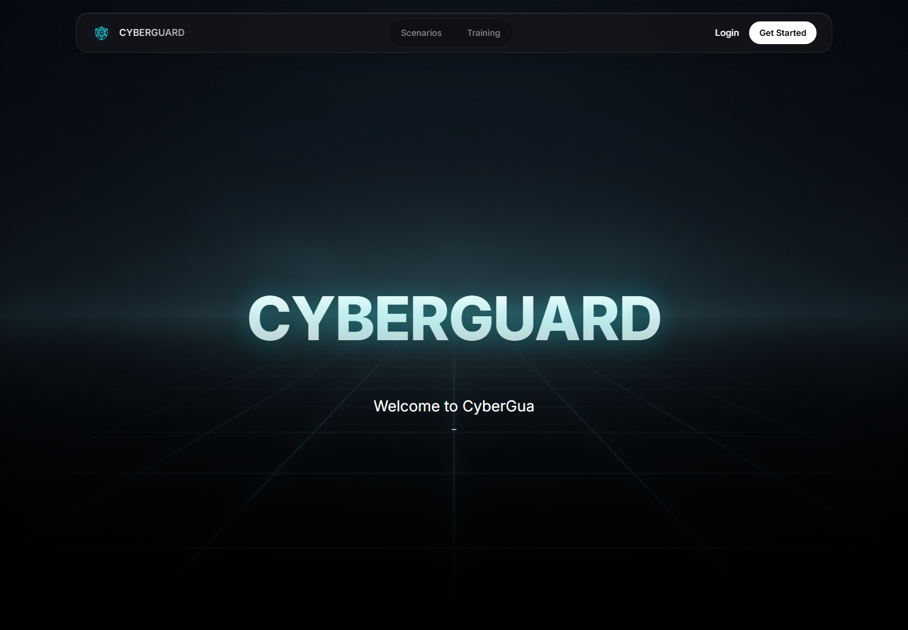

# CyberGuard Academy

CyberGuard Academy is a full-stack, scenario-driven cybersecurity learning platform. It turns awareness training into practical decisions: inspect a suspicious message, verify evidence, choose a response, and immediately see the operational consequence.

The project combines structured learning modules, interactive simulations, scored incident scenarios, progress tracking, certificates, and security-focused account controls in one cyber-themed experience.



## What it demonstrates

- Scenario-based training for phishing, social engineering, password security, digital-life safety, and incident response
- Branching exercises with evidence panels, scoring, feedback, failure states, and remediation guidance
- Role-based training arenas, progression, achievements, streaks, profiles, and generated certificates
- React interface with reusable simulation components and responsive cyber-themed presentation
- Express and MongoDB API with JWT authentication, password hashing, rate limiting, security headers, input sanitization, and audit logging
- Local development without a hosted database through an automatically seeded in-memory MongoDB instance

## Representative scenarios

| Exercise | Skills practiced |
| --- | --- |
| Operation Inbox Zero | Header analysis, look-alike domains, attachment risk, BEC, and external-share validation |
| Zero Day Meltdown | Containment, network segmentation, prioritization, and crisis decisions |
| The Friendly Stranger | Tailgating, pretexting, authority pressure, and physical security |
| The Gauntlet | Password hygiene, incident response, and security decision-making under pressure |

## Architecture

```text
React client
  -> learning modules and simulation registry
  -> authenticated training, scenarios, profile, and certificates
  -> Axios API client

Express API
  -> auth, training, scenarios, user progress, certificates, and administration
  -> Helmet, CORS, rate limiting, sanitization, and security-event logging
  -> MongoDB / Mongoose (Atlas or local in-memory development database)
```

## Run locally

Requirements: Node.js 20 or newer.

```bash
git clone https://github.com/NorShadeed/cyberguard-academy.git
cd cyberguard-academy
npm run install:all
```

Copy `server/.env.example` to `server/.env`, replace `JWT_SECRET`, and optionally configure MongoDB and mail settings. If `MONGO_URI` is empty, the API uses an in-memory development database.

Run the API and client in separate terminals:

```bash
npm run server
npm run client
```

Then open `http://localhost:3000`. The API health endpoint is `http://localhost:5000/health`.

## Validation

```bash
npm run build
node --check server/index.js
```

## Responsible use

The simulated messages, domains, incidents, and attacker behaviors are educational content. The platform does not send phishing messages or execute offensive actions against external systems.
